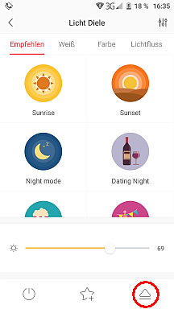
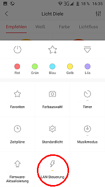
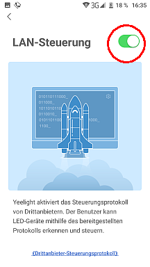
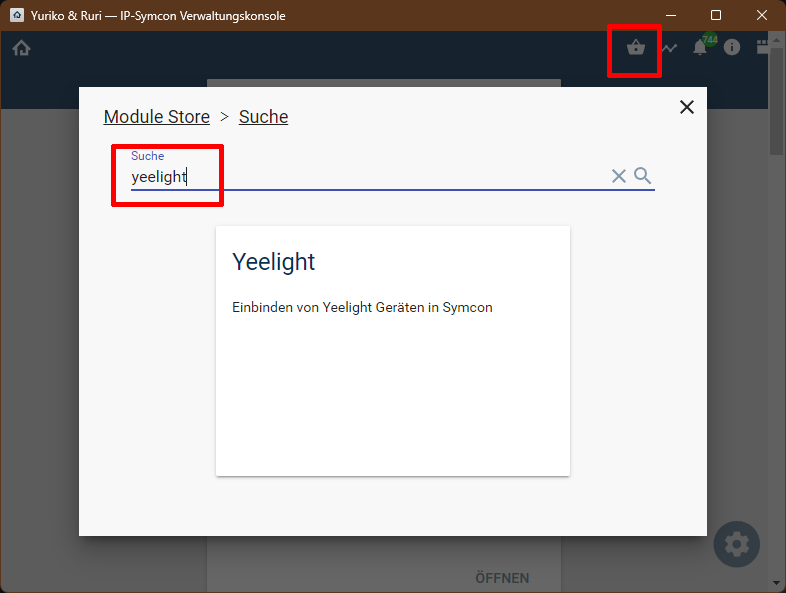

  

   

  

# Symcon-Modul: Yeelight <!-- omit in toc -->

Einbinden von Yeelight-Leuchten in Symcon über die lokale LAN-Steuerung, ohne Cloud.  

## Inhaltsverzeichnis <!-- omit in toc -->  

- [1. Funktionsumfang](#1-funktionsumfang)
- [Vorbemerkungen](#vorbemerkungen)
  - [Zur Library](#zur-library)
  - [Zur Integration von Geräten](#zur-integration-von-geräten)
- [2. Voraussetzungen](#2-voraussetzungen)
- [3. Software-Installation](#3-software-installation)
- [4. Enthaltende Module](#4-enthaltende-module)
  - [Yeelight Discovery](#yeelight-discovery)
  - [Yeelight Device](#yeelight-device)
- [5. Anhang](#5-anhang)
  - [1. GUID der Module](#1-guid-der-module)
  - [2. Changelog](#2-changelog)
  - [3. Spenden](#3-spenden)
- [6. Lizenz](#6-lizenz)

## 1. Funktionsumfang

- Findet alle Yeelight-Leuchten im lokalen Netzwerk und legt die Instanzen in Symcon an.  
- Zeigt die Zustände der Leuchten in Statusvariablen an und aktualisiert sie sofort, wenn sich etwas an der Leuchte ändert (auch durch App oder Schalter).  
- Steuert Ein/Aus, Helligkeit, Farbe (RGB und HSV), Weißton, Nachtlicht, Hintergrundlicht, Einschlaf-Timer, Szenen und Farbsequenzen.  
- Bedienung über die Statusvariablen in der Kachel-Visualisierung und im WebFront, über Aktionen und über PHP-Befehle.  

## Vorbemerkungen

### Zur Library

- Die Library nutzt das offizielle lokale Protokoll von Yeelight („Yeelight Inter-Operation“). Leuchten, die nur über die Xiaomi-Cloud oder Bluetooth gesteuert werden können, werden nicht unterstützt.  
- Welche Funktionen eine Leuchte hat (z.B. Farbe, Nachtlicht, Hintergrundlicht), meldet sie selbst. Die Instanz legt nur die passenden Statusvariablen an und lehnt Befehle ab, die die Leuchte nicht unterstützt.  
- Die Leuchten begrenzen die Anzahl der Befehle pro Minute. Wird die Grenze überschritten („Quota exceeded“), baut die Instanz die Verbindung automatisch neu auf und sendet den Befehl erneut.  

### Zur Integration von Geräten

Nachdem die Leuchten mit der Hersteller-App (Yeelight, nicht Xiaomi Home) in das Netzwerk eingebunden wurden, muss die LAN-Steuerung für jede Leuchte einzeln aktiviert werden.  
Aktuelle Versionen der App fragen dies nach dem Hinzufügen der Leuchte automatisch ab, da das Protokoll auch für die lokale Anbindung an Google Home genutzt wird.  

  

## 2. Voraussetzungen

- Symcon ab Version 8.2  
- Yeelight-Leuchte mit aktivierter LAN-Steuerung (siehe [Zur Integration von Geräten](#zur-integration-von-geräten))  
- Symcon und Leuchten im selben Netzwerk (Multicast für die Suche).  

> [!IMPORTANT]
> Die Leuchten antworten auf Anfragen mit UDP-Paketen. Eine Firewall auf dem Symcon-System muss diese ankommenden Antworten zulassen.  
> Läuft Symcon mit NAT-Unterstützung (z.B. Docker ohne Host-Netzwerk), muss zusätzlich Port 1983 (UDP) ankommend an Symcon weitergeleitet werden. Die Discovery funktioniert in dieser Konstellation nicht, die Instanzen werden dann von Hand angelegt.  

## 3. Software-Installation

Über den Module Store in der Konsole die Library 'Yeelight' hinzufügen.  

  

Nach der Installation fragt Symcon, ob die enthaltene [Discovery-Instanz](YeelightDiscovery/) angelegt werden soll. Bei Docker mit NAT kann diese Frage verneint werden.  

## 4. Enthaltende Module

### [Yeelight Discovery](YeelightDiscovery/)

Sucht alle Yeelight-Leuchten im Netzwerk und legt die Instanzen samt Client Socket an. Bereits angelegte Instanzen werden über die Geräte-ID erkannt, auch wenn sich die IP-Adresse der Leuchte geändert hat.  

### [Yeelight Device](YeelightDevice/)

Bindet eine Yeelight-Leuchte über einen Client Socket ein. Stellt die Statusvariablen, Aktionen und PHP-Befehle für alle Funktionen der Leuchte bereit.  

> [!TIP]
> Instanzen am einfachsten über die Discovery anlegen. Dabei werden Client Socket und Geräte-ID gleich richtig eingetragen.  

## 5. Anhang

### 1. GUID der Module

|       Modul        |    Typ    |  Prefix  |                  GUID                  |
| :----------------: | :-------: | :------: | :------------------------------------: |
| Yeelight Discovery | Discovery | YEELIGHT | {7AABB3D2-3D24-4F2C-86CE-A56FB09D188A} |
|  Yeelight Device   |  Device   | YEELIGHT | {BF5D53BB-EB4E-45C0-8632-5DB4EF49FA9F} |

### 2. Changelog

Version 2.16:

> [!IMPORTANT]
> - Symcon ab Version 8.2 wird benötigt.  
> - Die PHP-Befehle `YEELIGHT_SetToogle`, `YEELIGHT_SetBgToogle`, `YEELIGHT_SetToogleBoth` und `YEELIGHT_CircleBgColor` heißen jetzt `YEELIGHT_SetToggle`, `YEELIGHT_SetBgToggle`, `YEELIGHT_SetToggleBoth` und `YEELIGHT_RotateBgColor`. Die alten Namen funktionieren noch, erzeugen eine Warnung im Log und werden mit Version 2.20 entfernt.  
> - Wird 'HSV-Slider anzeigen' deaktiviert, bleiben die Variablen 'HSV Sättigung' erhalten. Nur die Slider-Variablen 'HSV Hue' werden gelöscht.  
> - Der HSV-Slider (nur WebFront) ist veraltet und bei neuen Instanzen standardmäßig deaktiviert. Für die Farbwahl die Variable 'HSV Farbe' bzw. 'RGB Farbe' verwenden.  
> - Ohne NAT nutzen Discovery und Geräte-Instanzen für die Antworten der Geräte zufällige UDP-Ports. Port 1983 wird nur noch bei aktiver NAT-Unterstützung (z.B. Docker) verwendet und muss nur dann weitergeleitet werden. Die Firewall muss ankommende UDP-Antworten der Geräte zulassen.  

**Neue Funktionen und Aktionen**

- Yeelight Device: `YEELIGHT_AdjustBrightness`, `YEELIGHT_AdjustWhiteTemp`, `YEELIGHT_AdjustColor` sowie `YEELIGHT_AdjustBgBrightness`, `YEELIGHT_AdjustBgWhiteTemp`, `YEELIGHT_AdjustBgColor` ändern Helligkeit, Farbtemperatur bzw. Farbe prozentual.  
- Yeelight Device: `YEELIGHT_SetNightLightBrightness` schaltet das Nachtlicht mit der angegebenen Helligkeit ein, 'Helligkeit Nachtlicht' ist bedienbar.  
- Yeelight Device: `YEELIGHT_SetSceneColor`, `YEELIGHT_SetSceneHSV`, `YEELIGHT_SetSceneWhite` (auch `…Bg…` für den Hintergrund) und `YEELIGHT_SetSceneAutoOff` schalten direkt mit Farbe, Weißton bzw. Einschlaf-Timer und Helligkeit ein, auch aus dem ausgeschalteten Zustand.  
- Yeelight Device: `YEELIGHT_StartMusicMode` und `YEELIGHT_StopMusicMode` verbinden das Gerät mit einem eigenen TCP-Server (Musikmodus, z.B. eine Server Socket Instanz) bzw. beenden diese Verbindung. Nach dem Beenden werden alle Statusvariablen neu gelesen.  
- Aktionen: Licht umschalten (Haupt-, Hintergrund- und beide Lichter), Farbe (HSV) setzen (auch Hintergrund), Hintergrundfarbe durchwechseln, Licht bzw. Hintergrundlicht prozentual ändern, Nachtlicht einschalten, Licht bzw. Hintergrundlicht mit Szene einschalten, Musikmodus starten oder beenden.  

**Neue Statusvariablen**

- Yeelight Device: 'Einschlaf-Timer' zeigt die Restlaufzeit in Minuten und kann den Timer setzen bzw. löschen.  
- Yeelight Device: 'Musikmodus aktiv' zeigt an, ob der Musikmodus läuft.  

**Geändertes Verhalten**

- 'HSV Farbe' enthält die Helligkeit des Gerätes, eine geänderte Helligkeit in der Farbwahl wird an das Gerät gesendet.  
- 'Aktueller Modus' ist in allen Modi als Aufzählung bedienbar.  
- 'Ablaufprogramm aktiv' zeigt aktiv/inaktiv an.  
- 'HSV Sättigung' wird von der Licht-Kachel nicht mehr als Helligkeit angeboten.  
- Fehlermeldungen werden ohne Datei- und Zeilenangabe an den Aufrufer gemeldet.  
- Ungültige Parameter (z.B. Weißton außerhalb 1700 bis 6500 K, Modus 4) werden vor dem Senden abgelehnt.  
- Unbekannte Eigenschaften des Gerätes erzeugen keine Log-Meldungen mehr, sondern nur Debug-Ausgaben.  
- Die Discovery sucht auf allen Netzwerkschnittstellen gleichzeitig, die Konfigurationsseite lädt dadurch deutlich schneller. Die Höhe der Geräteliste passt sich der Anzahl der Einträge an.  
- Yeelight Device hat die neue Eigenschaft 'Geräte ID'. Die Discovery trägt sie beim Anlegen ein und ordnet Geräte zuerst über diese ID zu. Eine geänderte IP-Adresse wird so erkannt und die Zeile grau dargestellt. Instanzen ohne Geräte ID werden weiterhin über den Host des Client Socket zugeordnet. Die vom Gerät gemeldete ID kann in der Instanzkonfiguration übernommen werden.  

**Behobene falsche Werte in Statusvariablen**

- Farbton und HSV-Farbe des Hintergrunds wurden nicht aktualisiert, stattdessen entstand eine falsche Variable 'HSV Hue Hintergrund'.  
- 'Aktueller Modus' zeigte im Modus 'Farbe und Nachtlicht' bzw. 'Weiß und Nachtlicht' nur Zahlen an, 'Weiß' hatte dort den falschen Wert.  
- Die HSV-Farbe des Hintergrunds hatte denselben Namen wie die des Hauptlichts (gilt für neu angelegte Variablen).  

**Fehlerbehebungen**

- `YEELIGHT_SetToogle`, `YEELIGHT_SetBgToogle` und `YEELIGHT_SetToogleBoth` wurden vom Gerät abgelehnt.  
- `YEELIGHT_GetSleep` lieferte nie die Restlaufzeit.  
- `YEELIGHT_SetRGBSmooth` und `YEELIGHT_SetBgRGBSmooth` ignorierten die Übergangszeit.  
- Aktion 'Hintergrundhelligkeit verringern' hat die Helligkeit erhöht.  
- Aktion 'Hintergrund als Standard speichern' hat den Standard des Hauptlichts gespeichert.  
- Aktion 'Einschalten / Modus setzen' mit 'Farbe (HSV)' hat eine Farbsequenz gestartet.  
- Nach einem automatischen Neuverbinden (Quota exceeded) meldete der Befehl einen Fehler, obwohl er ausgeführt wurde.  
- Debug-Ausgaben von Ereignissen mit Zahlenwerten brachen mit einem Fehler ab.  
- Die Discovery erkannte Docker mit NAT nicht zuverlässig.  
- Nach einem Neustart von Symcon konnten einzelne Instanzen die Fähigkeiten ihres Gerätes nicht ermitteln (Status 201), weil alle Instanzen gleichzeitig Port 1983 genutzt haben.  
- Ein geänderter Host am Client Socket wurde erst nach einem Neustart der Instanz berücksichtigt.  

Version 2.15:

- Version für Symcon 8.1
- Parameter Licht sanft ändern wurde bei Farbe ignoriert.
- HSV Variable ergänzt.
- SetScene und SetBgScene als Instanz-Funktion ergänzt.
- Umstellung auf Darstellungen.  
- Unterstützung für Kachel Visualisierung.  

Version 2.14:

- Fix: Erkennung von Eigenschaften welche beim initialen SSDP Response fehlen.  
  
Version 2.13:

- Instanz hat aktiven IO beim Neustart von Symcon nicht erkannt.  

Version 2.10:

- Quata exceeded Fehlermeldungen lösen einen automatischen Reconnect aus.  

Version 2.00:

- Betrieb der Geräte-Instanzen auch mit NAT (z.B. Docker) möglich.  
- VariablenProfile werden beim löschen mit entfernt.  
- Aktionen (inkl. Programmablauf) werden unterstützt.
- Debugausgaben waren unvollständig.  
- Fehlermeldungen von Geräten wurden nicht berücksichtigt.  
- Bessere Hinweise wenn es Probleme mit der Kommunikation gibt.  
- RGB Farbwahl war defekt.  
- UDP Kommunikation wird in Symcon ankommend auf Port 1983 erwartet.  
- Prefix für PHP-Befehle wurde auf "YEELIGHT" geändert.  
- IPS 6.1 wird benötigt.  

Version 1.80:  

- Unnötigen Code aus Discovery entfernt.  
- Discovery zeigt eine Meldung an, wenn keine Geräte gefunden wurden.  
  
Version 1.70:  

- YEELIGHT_SetMode schaltet Gerät immer an.  
- Zweites Profil für die Farbtemperatur bei Modus 'Weiß mit Nachtlicht'.  

Version 1.60:  

- Erweiterung für den Nachtlicht-Modus  

Version 1.50:  

- Release für IPS 5.1 und den Module-Store  

Version 1.00:  

- Erstes offizielles Release  

### 3. Spenden

Die Library ist für die nicht kommerzielle Nutzung kostenlos, Schenkungen als Unterstützung für den Autor werden hier akzeptiert:  

PayPal:  
  

Wunschliste:  
  

## 6. Lizenz

Symcon-Modul:  
[Custom NC-SA](LICENSE)  
