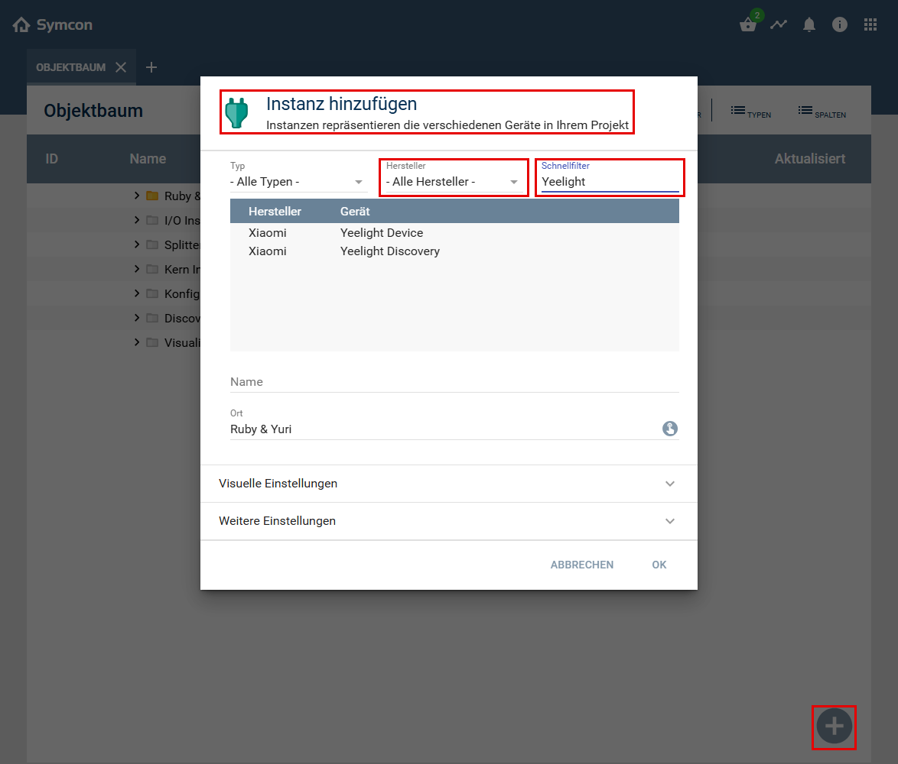
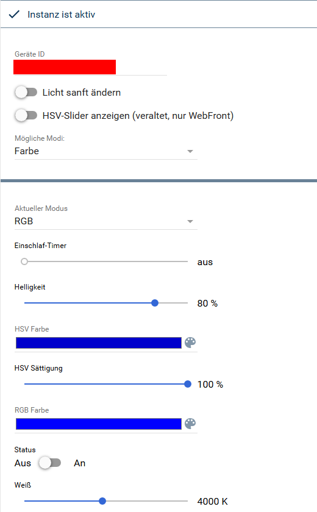
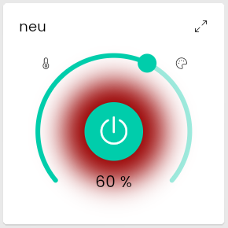
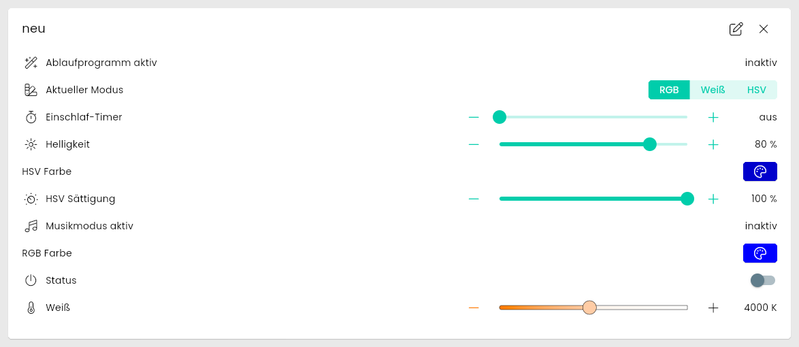
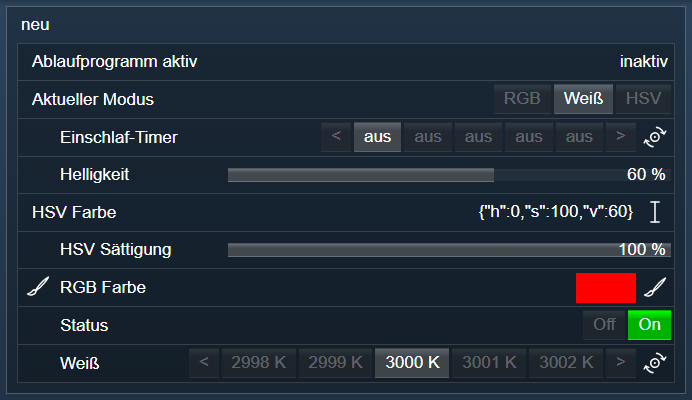

[](https://www.symcon.de/service/dokumentation/entwicklerbereich/sdk-tools/sdk-php/)
[](https://community.symcon.de/t/modul-xiaomi-yeelight/142578)
[](https://www.symcon.de/de/service/dokumentation/installation/migrationen/v80-v81-q3-2025/)  
[](#10-lizenz)
[](https://github.com/Nall-chan/Yeelight/actions) [](https://github.com/Nall-chan/Yeelight/actions)  
[](#2-spenden)
[](#2-spenden)  

# Yeelight Device <!-- omit in toc -->

Einbindung einer Yeelight-Leuchte in Symcon.  

## Inhaltsverzeichnis <!-- omit in toc -->

- [1. Funktionsumfang](#1-funktionsumfang)
- [2. Voraussetzungen](#2-voraussetzungen)
- [3. Software-Installation](#3-software-installation)
- [4. Einrichten der Instanzen in Symcon](#4-einrichten-der-instanzen-in-symcon)
- [5. Statusvariablen](#5-statusvariablen)
- [6. Visualisierung](#6-visualisierung)
  - [Kachel Visualisierung](#kachel-visualisierung)
  - [WebFront Visualisierung](#webfront-visualisierung)
- [7. PHP-Befehlsreferenz](#7-php-befehlsreferenz)
  - [Allgemein](#allgemein)
  - [Ein- und Ausschalten](#ein--und-ausschalten)
  - [Helligkeit, Farbe und Weißton](#helligkeit-farbe-und-weißton)
  - [Schrittweise und prozentual ändern](#schrittweise-und-prozentual-ändern)
  - [Szenen und Nachtlicht](#szenen-und-nachtlicht)
  - [Farbsequenzen](#farbsequenzen)
  - [Einschlaf-Timer](#einschlaf-timer)
  - [Musikmodus](#musikmodus)
  - [Sonstiges](#sonstiges)
  - [Hintergrundlicht](#hintergrundlicht)
  - [Veraltete Befehle](#veraltete-befehle)
- [8. Aktionen](#8-aktionen)
- [9. Anhang](#9-anhang)
  - [1. Changelog](#1-changelog)
  - [2. Spenden](#2-spenden)
- [10. Lizenz](#10-lizenz)

## 1. Funktionsumfang

- Zeigt den Zustand der Leuchte in Statusvariablen an. Änderungen meldet die Leuchte selbst, auch wenn sie per App oder Schalter bedient wird.  
- Steuert Ein/Aus, Helligkeit, Farbe (RGB und HSV), Weißton, Modus, Nachtlicht, Hintergrundlicht und Einschlaf-Timer über die Statusvariablen.  
- Weitere Funktionen (Szenen, Farbsequenzen, schrittweises und prozentuales Ändern, Musikmodus) über [Aktionen](#8-aktionen) und [PHP-Befehle](#7-php-befehlsreferenz).  

## 2. Voraussetzungen

- Symcon ab Version 8.2  
- Yeelight-Leuchte mit aktivierter LAN-Steuerung (siehe [Zur Integration von Geräten](../README.md#zur-integration-von-geräten))  

## 3. Software-Installation

Dieses Modul ist Bestandteil der [Yeelight-Library](../README.md#3-software-installation).  

## 4. Einrichten der Instanzen in Symcon

> [!TIP]
> Instanzen am einfachsten über die [Yeelight Discovery](../YeelightDiscovery/) anlegen. Sie trägt Host und Geräte-ID gleich richtig ein.  

Für das manuelle Anlegen ist das Modul im Dialog 'Instanz hinzufügen' unter dem Hersteller 'Xiaomi' oder über den Schnellfilter 'Yeelight' zu finden.  

  

Beim Anlegen wird automatisch ein 'Client Socket' erzeugt. Dort die IP-Adresse der Leuchte als 'Host' eintragen, Port '55443' und den Haken 'Aktiv' setzen.  

> [!IMPORTANT]
> Läuft Symcon mit NAT-Unterstützung (z.B. Docker ohne Host-Netzwerk), muss Port 1983 (UDP) ankommend an Symcon weitergeleitet werden. Ohne NAT muss nur die Firewall die UDP-Antworten der Leuchte zulassen.  

  

**Konfigurationsseite:**  

|                  Eigenschaft                   |   Name    |   Typ   | Standardwert |                                                        Beschreibung                                                        |
| :--------------------------------------------: | :-------: | :-----: | :----------: | :------------------------------------------------------------------------------------------------------------------------: |
|                   Geräte ID                    | DeviceId  | string  |      ''      |             ID der Leuchte (z.B. `0x0000000004d2b2e4`), damit die Discovery die Instanz auch bei neuer IP erkennt             |
|               Licht sanft ändern               | SetSmooth |  bool   |    false     |                       true = Änderungen über Statusvariablen mit 500 ms Übergangszeit statt sofort                        |
| HSV-Slider anzeigen (veraltet, nur WebFront)   | HUESlider |  bool   |    false     |       true = zusätzliche Variable 'HSV Hue' mit einem Farbton-Schieberegler für das WebFront (veraltet, siehe unten)       |
|                 Mögliche Modi                  |   Mode    | integer |      0       | Darstellung von 'Aktueller Modus' und 'Weiß': 0 = Farbe, 1 = Farbe und Nachtlicht, 2 = Weiß und Nachtlicht (2700 bis 6500 K) |

Die Geräte ID trägt die Discovery beim Anlegen ein. Bei vorhandenen Instanzen ohne Geräte ID zeigt die Konfiguration die von der Leuchte gemeldete ID an, mit 'Übernehmen' wird sie ins Feld eingetragen und mit 'Änderungen übernehmen' gespeichert.  

Beispiel für das Setzen per Skript:  

```php
IPS_SetProperty(12345, 'SetSmooth', true);
IPS_SetProperty(12345, 'Mode', 1);
IPS_ApplyChanges(12345);
```

## 5. Statusvariablen

Die Instanz legt nur die Variablen an, deren Werte die Leuchte meldet. Leuchten ohne Farbe, Nachtlicht oder Hintergrundlicht haben entsprechend weniger Variablen.  

|            Name             |   Typ   |    Ident    |                                          Beschreibung                                          |
| :-------------------------: | :-----: | :---------: | :--------------------------------------------------------------------------------------------: |
|           Status            |  bool   |    power    |                                     Leuchte ein- und ausschalten                                     |
|         Helligkeit          | integer |   bright    |                                    Helligkeit in Prozent                                     |
|          RGB Farbe          | integer |     rgb     |                                    Farbe als RGB-Wert                                     |
|          HSV Farbe          | string  |     hsv     |      Farbe im HSV-Farbraum (Farbwahl der Visualisierung), der Hellwert entspricht der Helligkeit       |
|        HSV Sättigung        | integer |     sat     |                                 Sättigung der Farbe in Prozent                                 |
|            Weiß             | integer |     ct      |                         Weißton in Kelvin (1700 bis 6500 K, je nach Leuchte)                         |
|       Aktueller Modus       | integer | color_mode  |              Modus der Leuchte: 1 = RGB, 2 = Weiß, 3 = HSV, 5 = Nachtlicht, umschaltbar              |
|    Helligkeit Nachtlicht    | integer |    nl_br    |              Helligkeit des Nachtlichts in Prozent, beim Ändern wird das Nachtlicht eingeschaltet              |
|    Ablaufprogramm aktiv     |  bool   |   flowing   |                            Eine Farbsequenz läuft (nur Anzeige)                            |
|       Einschlaf-Timer       | integer |  delayoff   |    Restzeit bis zum Ausschalten in Minuten, ein Wert setzt den Timer, 0 (aus) löscht ihn    |
|      Musikmodus aktiv       |  bool   |  music_on   |      Der [Musikmodus](#musikmodus) läuft (nur Anzeige), die übrigen Werte werden dann nicht aktualisiert      |
|           HSV Hue           | string  |     hue     |              Nur mit 'HSV-Slider anzeigen': Farbton-Schieberegler für das WebFront (veraltet)              |
|     Status Hintergrund      |  bool   |  bg_power   |                              Hintergrundlicht ein- und ausschalten                              |
|   Helligkeit Hintergrund    | integer |  bg_bright  |                             Helligkeit des Hintergrundlichts in Prozent                             |
|    RGB Farbe Hintergrund    | integer |   bg_rgb    |                              Farbe des Hintergrundlichts als RGB-Wert                              |
|    HSV Farbe Hintergrund    | string  |   bg_hsv    |                            Farbe des Hintergrundlichts im HSV-Farbraum                            |
|  HSV Sättigung Hintergrund  | integer |   bg_sat    |                              Sättigung des Hintergrundlichts in Prozent                              |
|       Weiß Hintergrund      | integer |    bg_ct    |                              Weißton des Hintergrundlichts in Kelvin                              |
| Aktueller Modus Hintergrund | integer |  bg_lmode   |                                   Modus des Hintergrundlichts                                   |
| Ablaufprogramm aktiv Hintergrund |  bool   | bg_flowing  |                            Eine Farbsequenz läuft im Hintergrund                            |
|     HSV Hue Hintergrund     | string  |   bg_hue    |                Nur mit 'HSV-Slider anzeigen': Farbton-Schieberegler des Hintergrunds                |

> [!NOTE]
> Der Wert der Variablen 'HSV Farbe' ist ein JSON-String mit Farbton `h` (0 bis 360), Sättigung `s` und Hellwert `v` (je 0 bis 100), z.B. `{"h":120,"s":86,"v":100}`.  

## 6. Visualisierung

### Kachel Visualisierung

Die Instanz wird als Licht-Kachel dargestellt. In den Einstellungen der Kachel kann für die Farbe 'RGB Farbe' oder 'HSV Farbe' gewählt werden, als Helligkeit 'Helligkeit'.  

  

Maximiert zeigt die Kachel alle Statusvariablen als Liste:  

  

> [!TIP]
> Für das Nachtlicht kann über Links auf 'Status' und 'Helligkeit Nachtlicht' eine zweite Licht-Kachel angelegt werden.  

### WebFront Visualisierung

Die Statusvariablen werden direkt dargestellt und sind bedienbar. Unterschiede zur Kachel-Visualisierung:  

- Symbole aus Font Awesome (z.B. bei Helligkeit und Einschlaf-Timer) werden nicht angezeigt.  
- 'HSV Farbe' erscheint als Text, für die Farbwahl im WebFront 'RGB Farbe' verwenden.  

  

## 7. PHP-Befehlsreferenz

Alle Befehle mit Rückgabewert `bool` liefern `true`, wenn die Leuchte den Befehl bestätigt hat. Im Fehlerfall wird eine Meldung ausgegeben und `false` zurückgegeben, z.B. bei ungültigen Werten, ausgeschalteter Verbindung oder wenn die Leuchte den Befehl nicht unterstützt.  

Die Übergangszeit `$Duration` wird in Millisekunden angegeben. Werte unter 30 schalten sofort um. Befehle ohne Übergangszeit nutzen 500 ms, wenn 'Licht sanft ändern' aktiv ist, sonst schalten sie sofort.  

> [!NOTE]
> Farb-, Helligkeits- und Weißton-Befehle werden von der Leuchte nur im eingeschalteten Zustand ausgeführt. Die [Szenen](#szenen-und-nachtlicht) schalten die Leuchte dagegen auch aus dem ausgeschalteten Zustand ein.  

### Allgemein

```php
bool YEELIGHT_RequestState(integer $InstanzID);
```

Liest alle Werte von der Leuchte und aktualisiert die Statusvariablen.  

### Ein- und Ausschalten

```php
bool YEELIGHT_SetPower(integer $InstanzID, bool $Value);
bool YEELIGHT_SetPowerSmooth(integer $InstanzID, bool $Value, integer $Duration);
```

Schaltet die Leuchte ein (`true`) oder aus (`false`).  

```php
bool YEELIGHT_SetToggle(integer $InstanzID);
bool YEELIGHT_SetToggleBoth(integer $InstanzID);
```

Schaltet die Leuchte um. `SetToggleBoth` schaltet Haupt- und Hintergrundlicht gemeinsam um (nur Leuchten mit Hintergrundlicht).  

```php
bool YEELIGHT_SetMode(integer $InstanzID, integer $Mode);
bool YEELIGHT_SetModeSmooth(integer $InstanzID, integer $Mode, integer $Duration);
```

Schaltet die Leuchte ein und setzt den Modus: `0` = Standard (letzter Zustand), `1` = RGB, `2` = Weiß, `3` = HSV, `5` = Nachtlicht.  

```php
YEELIGHT_SetMode(12345, 5); // Nachtlicht einschalten
```

### Helligkeit, Farbe und Weißton

```php
bool YEELIGHT_SetBrightness(integer $InstanzID, integer $Level);
bool YEELIGHT_SetBrightnessSmooth(integer $InstanzID, integer $Level, integer $Duration);
```

Setzt die Helligkeit in Prozent (0 bis 100, 0 wird als 1 gesendet, die kleinste Stufe der Leuchte).  

```php
bool YEELIGHT_SetRGB(integer $InstanzID, integer $Red, integer $Green, integer $Blue);
bool YEELIGHT_SetRGBSmooth(integer $InstanzID, integer $Red, integer $Green, integer $Blue, integer $Duration);
```

Setzt die Farbe aus Rot, Grün und Blau (je 0 bis 255).  

```php
bool YEELIGHT_SetHSV(integer $InstanzID, integer $HUE, integer $Saturation);
bool YEELIGHT_SetHSVSmooth(integer $InstanzID, integer $HUE, integer $Saturation, integer $Duration);
```

Setzt die Farbe aus Farbton `$HUE` (0 bis 359) und Sättigung `$Saturation` (0 bis 100).  

```php
YEELIGHT_SetHSVSmooth(12345, 240, 100, 1000); // in 1 s auf Blau
```

```php
bool YEELIGHT_SetWhite(integer $InstanzID, integer $Temperature);
bool YEELIGHT_SetWhiteSmooth(integer $InstanzID, integer $Temperature, integer $Duration);
```

Setzt den Weißton in Kelvin (1700 bis 6500). Manche Leuchten unterstützen nur einen Teil davon (z.B. ab 2700 K) und lehnen andere Werte ab.  

### Schrittweise und prozentual ändern

```php
bool YEELIGHT_IncreaseBright(integer $InstanzID);
bool YEELIGHT_DecreaseBright(integer $InstanzID);
bool YEELIGHT_IncreaseWhiteTemp(integer $InstanzID);
bool YEELIGHT_DecreaseWhiteTemp(integer $InstanzID);
bool YEELIGHT_RotateColor(integer $InstanzID);
```

Erhöht bzw. verringert Helligkeit oder Weißton um eine von der Leuchte festgelegte Stufe, bzw. wechselt zur nächsten Farbe.  

```php
bool YEELIGHT_AdjustBrightness(integer $InstanzID, integer $Percentage, integer $Duration);
bool YEELIGHT_AdjustWhiteTemp(integer $InstanzID, integer $Percentage, integer $Duration);
bool YEELIGHT_AdjustColor(integer $InstanzID, integer $Percentage, integer $Duration);
```

Ändert Helligkeit, Weißton bzw. Farbe relativ um `$Percentage` (-100 bis 100). `$Duration` ist mindestens 30 ms.  

```php
YEELIGHT_AdjustBrightness(12345, -20, 500); // Helligkeit um 20 % verringern
```

### Szenen und Nachtlicht

Szenen schalten die Leuchte ein (auch aus dem ausgeschalteten Zustand) und setzen Farbe bzw. Weißton und Helligkeit in einem Schritt. `$Brightness` ist die Helligkeit in Prozent (0 bis 100, 0 wird als 1 gesendet).  

```php
bool YEELIGHT_SetSceneColor(integer $InstanzID, integer $Color, integer $Brightness);
bool YEELIGHT_SetSceneHSV(integer $InstanzID, integer $HUE, integer $Saturation, integer $Brightness);
bool YEELIGHT_SetSceneWhite(integer $InstanzID, integer $Temperature, integer $Brightness);
```

`$Color` ist ein RGB-Wert (0 bis 0xFFFFFF), Farbton, Sättigung und Weißton wie bei `SetHSV` bzw. `SetWhite`.  

```php
YEELIGHT_SetSceneWhite(12345, 4000, 50); // einschalten mit 4000 K und 50 %
```

```php
bool YEELIGHT_SetSceneAutoOff(integer $InstanzID, integer $Brightness, integer $Minutes);
```

Schaltet mit der angegebenen Helligkeit ein und nach `$Minutes` Minuten (ab 1) wieder aus.  

```php
bool YEELIGHT_SetNightLightBrightness(integer $InstanzID, integer $Level);
```

Schaltet das Nachtlicht mit der Helligkeit `$Level` in Prozent ein (nur Leuchten mit Nachtlicht).  

```php
bool YEELIGHT_SetScene(integer $InstanzID, string $Params);
```

Sendet eine Szene mit eigenen Parametern als JSON-Array, z.B. `'["cf", 0, 0, "500,1,255,100,1000,1,16776960,70"]'` (Farbsequenz). Die Parameter sind in der Yeelight-Spezifikation zu `set_scene` beschrieben.  

### Farbsequenzen

```php
bool YEELIGHT_StartColorFlow(integer $InstanzID, integer $Loops, integer $RecoverState, string $Flow);
bool YEELIGHT_StopColorFlow(integer $InstanzID);
```

Startet bzw. beendet eine Farbsequenz.  

- `$Loops`: Anzahl der Schritte, die ausgeführt werden (0 = endlos).  
- `$RecoverState`: Verhalten nach dem Ende: `0` = vorherigen Zustand wiederherstellen, `1` = im letzten Zustand bleiben, `2` = ausschalten.  
- `$Flow`: JSON-Array mit vier Werten je Schritt: Dauer in ms (ab 50), Modus (`1` = Farbe, `2` = Weißton, `7` = Pause), Wert (RGB-Farbe bzw. Kelvin, bei Pause ignoriert), Helligkeit (1 bis 100 oder -1 = unverändert).  

```php
// Rot und Blau im Wechsel, je 1 s, endlos
YEELIGHT_StartColorFlow(12345, 0, 0, json_encode([1000, 1, 0xFF0000, 100, 1000, 1, 0x0000FF, 100]));
```

### Einschlaf-Timer

```php
bool YEELIGHT_SetSleep(integer $InstanzID, integer $Minutes);
integer YEELIGHT_GetSleep(integer $InstanzID);
bool YEELIGHT_DelSleep(integer $InstanzID);
```

Startet den Timer, die Leuchte schaltet nach `$Minutes` Minuten (ab 1) aus. `GetSleep` liefert die Restzeit in Minuten, `0` wenn kein Timer läuft. `DelSleep` löscht den Timer.  

### Musikmodus

```php
bool YEELIGHT_StartMusicMode(integer $InstanzID, string $Host, integer $Port);
bool YEELIGHT_StopMusicMode(integer $InstanzID);
```

Die Leuchte verbindet sich als TCP-Client zu einem eigenen TCP-Server unter `$Host` (IP-Adresse) und `$Port`, z.B. einer 'Server Socket' Instanz in Symcon. Über diese Verbindung kann ein anderes Programm oder Skript Befehle ohne Begrenzung pro Minute senden, z.B. für Lichteffekte zur Musik. Die Befehle haben dasselbe JSON-Format wie in der Yeelight-Spezifikation, jeweils mit `\r\n` abgeschlossen.  

`StopMusicMode` beendet den Musikmodus und liest danach alle Werte der Leuchte neu. Ohne laufenden Musikmodus meldet die Leuchte einen Fehler.  

> [!NOTE]
> Solange der Musikmodus läuft, meldet die Leuchte keine Änderungen. Die Statusvariablen werden erst nach `StopMusicMode` wieder aktualisiert. Die Instanz kann die Leuchte in dieser Zeit weiterhin über ihre eigene Verbindung steuern.  

```php
// Musikmodus mit einer Server Socket Instanz (Port 18000) auf dem Symcon-System 192.168.1.10
YEELIGHT_StartMusicMode(12345, '192.168.1.10', 18000);
SSCK_SendText(54321, json_encode(['id' => 1, 'method' => 'set_rgb', 'params' => [0x00FF00, 'smooth', 300]]) . "\r\n");
YEELIGHT_StopMusicMode(12345);
```

### Sonstiges

```php
bool YEELIGHT_SetDefault(integer $InstanzID);
```

Speichert den aktuellen Zustand als Einschaltzustand in der Leuchte.  

```php
bool YEELIGHT_SetName(integer $InstanzID, string $Name);
```

Setzt den in der Leuchte gespeicherten Namen (erscheint z.B. in der Discovery).  

### Hintergrundlicht

Leuchten mit Hintergrundlicht unterstützen dieselben Befehle mit `Bg` im Namen, die Parameter sind identisch:  

|              Hauptlicht              |              Hintergrundlicht               |
| :----------------------------------: | :-----------------------------------------: |
|  `SetPower`, `SetPowerSmooth`        |  `SetBgPower`, `SetBgPowerSmooth`           |
|  `SetToggle`                         |  `SetBgToggle`                              |
|  `SetMode`, `SetModeSmooth`          |  `SetBgMode`, `SetBgModeSmooth` (Ein/Aus bleibt erhalten) |
|  `SetBrightness`, `…Smooth`          |  `SetBgBrightness`, `…Smooth`               |
|  `SetRGB`, `SetRGBSmooth`            |  `SetBgRGB`, `SetBgRGBSmooth`               |
|  `SetHSV`, `SetHSVSmooth`            |  `SetBgHSV`, `SetBgHSVSmooth`               |
|  `SetWhite`, `SetWhiteSmooth`        |  `SetBgWhite`, `SetBgWhiteSmooth`           |
|  `Increase…`, `Decrease…`            |  `IncreaseBg…`, `DecreaseBg…`               |
|  `RotateColor`                       |  `RotateBgColor`                            |
|  `Adjust…`                           |  `AdjustBg…`                                |
|  `SetSceneColor`, `…HSV`, `…White`   |  `SetBgSceneColor`, `…HSV`, `…White`        |
|  `SetScene`                          |  `SetBgScene`                               |
|  `StartColorFlow`, `StopColorFlow`   |  `StartBgColorFlow`, `StopBgColorFlow`      |
|  `SetDefault`                        |  `SetBgDefault`                             |

```php
YEELIGHT_SetBgRGB(12345, 255, 128, 0); // Hintergrundlicht orange
```

### Veraltete Befehle

Diese Namen funktionieren noch, schreiben eine Warnung ins Log und werden mit Version 2.20 entfernt:  

|     Veraltet      |       Neu       |
| :---------------: | :-------------: |
|    SetToogle      |    SetToggle    |
|   SetBgToogle     |   SetBgToggle   |
|  SetToogleBoth    |  SetToggleBoth  |
|  CircleBgColor    |  RotateBgColor  |

## 8. Aktionen

**Grundsätzlich können alle bedienbaren Statusvariablen als Ziel einer [`Aktion`](https://www.symcon.de/service/dokumentation/konzepte/automationen/ablaufplaene/aktionen/) mit `Auf Wert schalten` angesteuert werden, so dass hier keine speziellen Aktionen benutzt werden müssen.**

Zusätzlich gibt es Aktionen speziell für die 'Yeelight Device' Instanz. Sie stehen zur Auswahl, wenn als Ziel eine 'Yeelight Device' Instanz gewählt ist, und können in Ereignissen, Ablaufplänen, über 'Befehl einfügen' im Skript-Editor und über 'Befehle testen' im Kontextmenü genutzt werden. Für das Hintergrundlicht gibt es jeweils eine eigene Aktion.  

- Einschalten / Modus setzen, Ausschalten, Licht umschalten, Haupt- und Hintergrundlicht umschalten  
- Helligkeit setzen, Farbe (RGB) setzen oder faden, Farbe (HSV) setzen oder faden, Farbtemperatur setzen  
- Helligkeit bzw. Farbtemperatur erhöhen oder verringern, Farbe durchwechseln, Licht prozentual ändern  
- Licht mit Szene einschalten (Farbe, HSV, Weiß, automatisch ausschalten), Nachtlicht einschalten  
- Ablaufprogramm ausführen bzw. beenden  
- Einschlaf-Timer setzen bzw. löschen  
- Als Standard speichern  
- Musikmodus starten oder beenden  

## 9. Anhang

### 1. Changelog

[Changelog der Library](../README.md#2-changelog)  

### 2. Spenden

Die Library ist für die nicht kommerzielle Nutzung kostenlos, Schenkungen als Unterstützung für den Autor werden hier akzeptiert:  

PayPal:  
[](https://paypal.me/Nall4chan)  

Wunschliste:  
[](https://www.amazon.de/hz/wishlist/ls/YU4AI9AQT9F?ref_=wl_share)  

## 10. Lizenz

Symcon-Modul:  
[Custom NC-SA](../LICENSE)  
