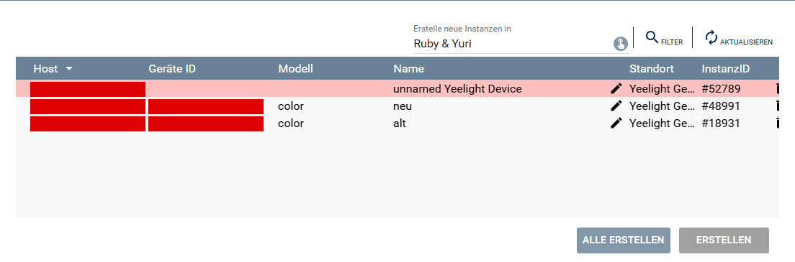

  

   

  

# Yeelight Discovery <!-- omit in toc -->

Sucht Yeelight-Leuchten im lokalen Netzwerk und legt die Instanzen in Symcon an.  

## Inhaltsverzeichnis <!-- omit in toc -->

- [1. Funktionsumfang](#1-funktionsumfang)
- [2. Voraussetzungen](#2-voraussetzungen)
- [3. Software-Installation](#3-software-installation)
- [4. Einrichten der Instanzen in Symcon](#4-einrichten-der-instanzen-in-symcon)
- [5. Statusvariablen](#5-statusvariablen)
- [6. Visualisierung](#6-visualisierung)
- [7. PHP-Befehlsreferenz](#7-php-befehlsreferenz)
- [8. Aktionen](#8-aktionen)
- [9. Anhang](#9-anhang)
  - [1. Changelog](#1-changelog)
  - [2. Spenden](#2-spenden)
- [10. Lizenz](#10-lizenz)

## 1. Funktionsumfang

- Findet alle Yeelight-Leuchten mit aktivierter LAN-Steuerung im Netzwerk, auf allen Netzwerkschnittstellen gleichzeitig.  
- Legt [Yeelight Device](../YeelightDevice/) Instanzen samt Client Socket an.  
- Erkennt bereits angelegte Instanzen über die Geräte-ID, auch wenn sich die IP-Adresse der Leuchte geändert hat.  

## 2. Voraussetzungen

- Symcon ab Version 8.2  
- Yeelight-Leuchte mit aktivierter LAN-Steuerung (siehe [Zur Integration von Geräten](../README.md#zur-integration-von-geräten))  
- Symcon und Leuchten im selben Netzwerk, die Firewall muss die UDP-Antworten der Leuchten zulassen.  

> [!NOTE]
> Mit Docker und NAT (ohne Host-Netzwerk) funktioniert die Suche nicht, weil Docker kein Multicast weiterleitet. Die Instanz zeigt dann einen Hinweis an, die [Yeelight Device](../YeelightDevice/) Instanzen werden von Hand angelegt.  

## 3. Software-Installation

Dieses Modul ist Bestandteil der [Yeelight-Library](../README.md#3-software-installation).  

## 4. Einrichten der Instanzen in Symcon

Die Instanz wird nach der Installation der Library auf Nachfrage automatisch angelegt und ist im Objektbaum unter 'Discovery Instanzen' zu finden. Andernfalls ist sie im Dialog 'Instanz hinzufügen' unter dem Hersteller 'Xiaomi' bzw. über den Schnellfilter 'Yeelight' zu finden.  

Beim Öffnen der Instanz oder über 'Aktualisieren' dauert die Suche etwa 3 Sekunden. Danach zeigt die Liste alle gefundenen Leuchten und alle vorhandenen Yeelight Device Instanzen.  

  

| Spalte    | Beschreibung                                                              |
| :-------- | :------------------------------------------------------------------------ |
| Host      | IP-Adresse bzw. Hostname der Leuchte                                       |
| Geräte ID | ID der Leuchte                                                             |
| Modell    | Modell laut Leuchte (z.B. `color`, `ceiling`)                              |
| Name      | in der Leuchte gespeicherter Name bzw. Name der vorhandenen Instanz        |
| Standort  | Ort der vorhandenen Instanz im Objektbaum                                  |

Über 'Erstellen' wird eine einzelne Instanz angelegt, alternativ alle fehlenden auf einmal. Neue Instanzen landen in der Kategorie 'Yeelight Geräte' und können danach frei verschoben werden. Dabei werden der Client Socket mit Host und Port sowie die Geräte ID der Instanz eingetragen.  

Zuordnung zu vorhandenen Instanzen:  

- Zuerst über die Geräte ID der Instanz.  
- Instanzen ohne Geräte ID (angelegt mit älteren Versionen) über den Host des Client Socket.  

Ist eine Zeile grau, weicht die vorhandene Instanz von der gefundenen Leuchte ab, z.B. weil die Leuchte eine neue IP-Adresse hat oder der Instanz noch die Geräte ID fehlt.  

## 5. Statusvariablen

Die Instanz besitzt keine Statusvariablen.  

## 6. Visualisierung

Die Instanz besitzt keine Elemente für die Visualisierung.  

## 7. PHP-Befehlsreferenz

Die Instanz besitzt keine Instanz-Funktionen.  

## 8. Aktionen

Die Instanz besitzt keine Aktionen.  

## 9. Anhang

### 1. Changelog

[Changelog der Library](../README.md#2-changelog)  

### 2. Spenden

Die Library ist für die nicht kommerzielle Nutzung kostenlos, Schenkungen als Unterstützung für den Autor werden hier akzeptiert:  

PayPal:  
  

Wunschliste:  
  

## 10. Lizenz

Symcon-Modul:  
[Custom NC-SA](../LICENSE)  
